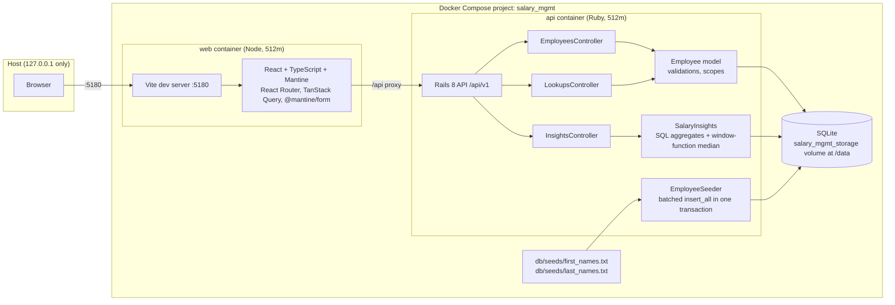

# Salary Management Tool: Plan

## 1. Who uses it and what they ask

The user is an HR manager responsible for about 10,000 employees across several countries. These are the questions they come to the tool with:

1. "Someone joined, left or got a raise. Let me record it." (create, update, delete)
2. "Find Priya Sharma and show me her record." (search by name, view one employee)
3. "Show me everyone in Germany who is a Software Engineer." (filter by country and job title)
4. "What is the lowest, highest and average salary we pay in India?" (requirement a)
5. "What do we pay a Data Analyst in Canada on average?" (requirement b)
6. "Is that number based on 3 people or 300?" (headcount next to every average)
7. "Is the average misleading because of a few very high salaries?" (median next to average)
8. "How much does each country cost us per year, and how do the countries compare?" (payroll and the country comparison)
9. "Within one country, which job titles have the widest pay range?" (min/max per title, as a first check on pay consistency)
10. "Is our Canada salary for this title above or below what we pay for the same title elsewhere?" (title average in the country vs. the same title across all countries)

## 2. Scope

In scope:

- Employee CRUD through a React UI backed by a Rails JSON API and SQLite.
- Server-side pagination, name search, and filters by country and job title.
- Salary insights: requirements (a) and (b), plus headcount, median, payroll, the country comparison, the job-title breakdown per country, and the title-vs-global comparison.
- A fast, deterministic, re-runnable seed that creates 10,000 employees.
- Unit, request and component tests; linting and type checking.
- A Docker-only development setup, isolated from other projects on the machine.

Out of scope, with the reason:

| Item | Reason |
| --- | --- |
| Authentication and roles | There is a single persona and no deployment. It is the first thing I'd add before real use. |
| Multiple currencies | Comparing salaries across countries needs one unit. Every salary is annual USD. |
| Salary history and audit trail | Useful, but it doubles the data model. Updates overwrite the value. |
| Soft delete or archiving | The brief asks for delete. A real HR system would archive. |
| CSV import/export, charts, i18n | Not needed to answer the questions above. |
| Deployment and video demo | Deferred: required by the brief's Readiness section, planned after the core app is complete. |

## 3. Data model

A single table, `employees`.

| Column | Type | Rules | Why it exists |
| --- | --- | --- | --- |
| `id` | integer PK | | |
| `full_name` | string | required, trimmed, max 120 | Brief |
| `job_title` | string | required, trimmed, max 100 | Brief. The grouping key for requirement (b). |
| `country` | string | required, one of `Employee::COUNTRIES` | Brief. A fixed list, so "USA" and "United States" can't split one group in two. |
| `salary` | integer | required, > 0, ≤ 10,000,000 | Brief. Annual gross in USD, whole dollars. An integer avoids float rounding in sums and averages. |
| `department` | string | required, one of `Employee::DEPARTMENTS` | HR managers think in departments as well as titles. It is a filter and a column in the table, and it gives the seed realistic title-to-salary bands. |
| `email` | string | required, format, unique (case-insensitive, stored lowercased) | Names are not unique: 10,000 names drawn from two lists will collide. Email is the human-facing identity that tells two "John Smith"s apart. |
| `hire_date` | date | required, not in the future | Shows tenure on the detail page and leaves room for tenure-based metrics later. A real HR record always has one. |
| `created_at`, `updated_at` | datetime | | Rails default |

Indexes:

- `country`: country insights and the country filter.
- `(country, job_title)`: the requirement (b) lookup and the per-country title breakdown (a covering prefix for `GROUP BY country, job_title`).
- `job_title`: the job title filter and the title-across-countries comparison.
- `email`, unique.

Job titles are free text, trimmed. The form offers the existing titles through an autocomplete so new spellings are rare. A separate `job_titles` table would be stricter, but it adds CRUD the brief doesn't ask for.

## 4. API

All JSON, under `/api/v1`. In development the Vite server proxies `/api` to Rails, so the browser sees one origin and no CORS setup is needed.

### Employees

| Method | Path | Notes |
| --- | --- | --- |
| GET | `/employees` | `page` (default 1), `per_page` (default 25, max 100), `q` (name contains, case-insensitive), `country`, `job_title`. Ordered by `full_name, id`. |
| GET | `/employees/:id` | |
| POST | `/employees` | Body `{ employee: { ... } }`. Returns 201. |
| PATCH | `/employees/:id` | Returns 200. |
| DELETE | `/employees/:id` | Returns 204. |
| GET | `/lookups` | `{ countries, departments, job_titles }`. Countries and departments come from the model constants, job titles from `DISTINCT` in the DB. Used by filters and forms. |

List response:

```json
{
  "employees": [{ "id": 1, "full_name": "...", "job_title": "...", "country": "...", "department": "...", "salary": 85000, "email": "...", "hire_date": "2021-03-01" }],
  "meta": { "page": 1, "per_page": 25, "total_count": 10000, "total_pages": 400 }
}
```

Errors:

- 404: `{ "error": "Employee not found" }`
- 422: `{ "errors": { "email": ["has already been taken"], "salary": ["must be greater than 0"] } }`. The keys match the form field names, so the UI can attach each message to its field.
- 400: `{ "error": "param is missing or the value is empty: employee" }`

Pagination is implemented directly with `limit`/`offset` and one `count`, so no pagination gem is needed.

### Insights

| Method | Path | Returns |
| --- | --- | --- |
| GET | `/insights/summary` | Org-wide headcount, average, median, total payroll, number of countries. |
| GET | `/insights/countries` | One row per country: headcount, min, max, average, median, payroll. This is the country comparison. |
| GET | `/insights/country?country=India` | That country's headcount, min, max, average, median and payroll (requirement a), plus `job_titles`: one row per title with headcount, min, max and average. |
| GET | `/insights/job_title?country=India&job_title=Data%20Analyst` | Headcount, average, min and max for the title in the country (requirement b), plus the country average and the same title's average across all countries. |

Country and job title go in query parameters, not path segments, because both contain spaces and job titles can contain `/`.

An unknown country or title returns 200 with `headcount: 0` and null stats, so the UI can show an empty state. A missing parameter returns 400.

All numbers come from SQL aggregates in one service object, `SalaryInsights`. The median uses window functions (`ROW_NUMBER()` and `COUNT(*) OVER (PARTITION BY ...)`), which SQLite has supported since 3.25, so even the median never loads salaries into Ruby. Averages are rounded to whole dollars.

## 5. Screens

The layout is a Mantine `AppShell` with two nav links: Employees and Insights. Server state is handled by TanStack Query, forms by `@mantine/form`, and routing by React Router.

1. **Employees list** (`/employees`)
   - A search box (debounced), a country select and a job title select. Changing any of them resets the list to page 1.
   - Table columns: name, job title, department, country, salary (formatted as USD), hire date. Clicking a row opens the detail page.
   - Server-side pagination showing "Showing 26–50 of 10,000".
   - An "Add employee" button.
   - States: skeleton rows while loading, "No employees match these filters" with a clear-filters button, and an error alert with a retry button.
2. **Employee detail** (`/employees/:id`)
   - All fields, with tenure derived from the hire date.
   - Edit and Delete buttons. Delete opens a confirmation modal that names the employee, then returns to the list with a notification.
   - A not-found state for a 404.
3. **Employee form** (`/employees/new`, `/employees/:id/edit`)
   - One form component for both pages.
   - Client-side validation mirrors the model: required fields, email format, salary greater than 0, hire date not in the future.
   - Server 422 errors are set on the matching fields.
   - The submit button shows a loading state.
4. **Insights** (`/insights`)
   - An org summary strip: headcount, average, median, payroll.
   - Country select → stat cards for min, max, average, median, headcount and payroll (requirement a).
   - Job title select (limited to titles present in that country) → the title's average, headcount and range, with "vs country average" and "vs same title globally" shown as a percentage difference (requirement b).
   - The job-title table for the selected country, sortable by average.
   - The country comparison table.
   - Each section has its own loading, empty and error states.

## 6. Insight metrics and why each helps

| Metric | Why the HR manager needs it |
| --- | --- |
| Min / max / average per country | Requirement (a). Answers "what is the pay range here". |
| Average per job title in a country | Requirement (b). The number used for offers and raises. |
| Headcount next to every aggregate | An average of 2 people is not a benchmark. Without headcount, every other number can mislead. |
| Median | A few executive salaries pull the mean up. When mean and median differ a lot, the distribution is skewed. |
| Total payroll per country | The budget question: "what does this country cost us per year". |
| Country comparison table | Shows where pay and headcount concentrate, and which countries are outliers. |
| Min/max per title within a country | A wide range for the same title in the same country is the first sign of inconsistent pay worth investigating. |
| Title average vs country average and vs global title average | Shows whether a role is paid above or below the local norm and the same role elsewhere. |

## 7. Seed design

- **Entry point:** `bin/rails db:seed` calls `EmployeeSeeder.new.call`. The seeder lives in `app/services`, so specs can call it with a small count and fixture name files.
- **Inputs:** `db/seeds/first_names.txt` and `db/seeds/last_names.txt`, one name per line, stripped, with blanks and duplicates removed. A missing or empty file raises a clear error before anything is deleted.
- **Determinism:** one `Random.new(SEED)` drives every choice, so the same files always produce the same 10,000 rows. Nothing uses `Time.now` except as a fixed reference date passed in.
- **Realism:**
  - A small catalog maps each department to job titles with a base USD salary.
  - Each country has a headcount weight and a pay multiplier.
  - Each salary is base × multiplier × a random factor between 0.85 and 1.15, rounded to the nearest 100.
  - Hire dates are spread over the last 15 years.
  - Emails are `first.last.<n>@example.com`, so they are unique by construction.
- **Speed:**
  - All attribute hashes are built in memory first, with no Active Record objects.
  - One transaction wraps `Employee.delete_all` and `insert_all` in batches of 1,000.
  - SQLite pays one fsync for the whole transaction instead of one per row.
  - The seed prints the row count and elapsed time.
- **Re-runnable:** the seed replaces all rows instead of appending, so running it twice still leaves exactly 10,000 rows and no duplicate emails.
- **Validity:** `insert_all` skips model validations. The spec makes up for that by checking that every generated row passes `Employee.new(attrs).valid?`.
- **Benchmark:** 1,000 rows inserted one at a time with `Employee.create!` vs. the batched path, recorded in `docs/DECISIONS.md`.

## 8. Testing approach

Backend, RSpec:

- **Model:** presence, length, inclusion, numericality, email format and uniqueness (including case), future hire date, whitespace and email normalization.
- **Requests, employees:**
  - Pagination meta and the `per_page` cap.
  - Search, the country and job title filters, and the combination of all three.
  - Show, create, update and delete.
  - 404, 422 with the field error shape, and 400.
- **Requests, insights:** the response shape for each endpoint, and 400 for a missing parameter.
- **`SalaryInsights` unit specs:** a small fixed dataset whose min, max, average, median (odd and even counts) and payroll are worked out by hand in the spec, plus the empty-country case.
- **`EmployeeSeeder` specs:**
  - Count, and that names come from the given files.
  - Every row is valid, and emails are unique.
  - Same output on two runs.
  - A re-run replaces rows instead of adding them.
  - A missing file raises and leaves existing rows untouched.
  - These use small fixture name files and a small count to stay fast. One example runs the default 10,000.
- **Data setup:** FactoryBot with explicit attributes, so tests don't depend on random data.

Frontend, Vitest + React Testing Library:

- The network is mocked with MSW at the fetch level, so components run their real data-fetching code.
- **Employees:** the list renders rows and pagination; search and filters send the right query; loading, empty and error states; the form's client validation; server 422 errors appear on the fields; delete asks for confirmation before calling the API.
- **Insights:** choosing a country shows min/max/avg; choosing a title shows its average and comparisons; empty and error states.

Quality gates for every milestone:

- RuboCop (`rubocop-rails-omakase`), oxlint (the linter the current Vite template ships with) and `tsc -b` pass.
- Both test suites pass.
- A comment grep finds no comments.
- The Docker isolation check is clean.

## 9. Architecture



## 10. Trade-offs

| Decision | Chosen | Alternative | Why |
| --- | --- | --- | --- |
| Database | SQLite | Postgres | Required by the brief. One HR manager writing occasionally fits SQLite's single writer. Aggregates over 10,000 rows take milliseconds. |
| Pagination | Offset | Keyset | At 10,000 rows, an `OFFSET` scan is negligible, and offset gives page numbers, which is what the UI shows. |
| Name search | `LIKE '%q%'` | SQLite FTS5 | A leading wildcard can't use an index, but a full scan of 10,000 short strings is about a millisecond. FTS5 is the next step if the table grows by orders of magnitude. |
| Median | SQL window functions | Load salaries into Ruby | Keeps "all from SQL aggregates" true and avoids moving data. It costs a slightly more complex query, which the unit tests cover. |
| Insight caching | None | Cache keyed on `Employee.maximum(:updated_at)` | Current queries are fast. Caching adds invalidation bugs for no measurable gain at this size. |
| Currency | Single (USD) | Local currency + FX table | Cross-country comparison needs one unit. Multi-currency is a separate feature. |
| Country / department | Fixed lists in the model | Free text or lookup tables | Free text breaks grouping. Lookup tables add CRUD nobody asked for. |
| Job title | Free text + autocomplete | Lookup table | Titles change more often than countries. The autocomplete reduces spelling drift. |
| Seed inserts | `insert_all` in batches, one transaction | `create!` per row | Orders of magnitude faster. Validations are skipped, which the specs make up for. |
| Seed re-run | Replace all rows | Upsert by email | Simpler and always ends at exactly 10,000 rows. It discards manual edits, which is acceptable for dev data. |
| Cross-origin | Vite proxy | `rack-cors` | One origin in development, one gem fewer. A production build would be served behind the same reverse proxy. |
| Delete | Hard delete | Soft delete | Matches the brief. Archiving is listed as next. |
| Tooling | Everything in Docker | Host Ruby/Node | Keeps the host toolchains of other projects untouched. It costs some first-build time. |
| Memory | api 512m, web 512m; one image build at a time | Larger caps | Docker on this machine is shared with other projects. Before each build and before starting containers I check `docker stats --no-stream` and stop if usage would pass about 85%. |

## 11. Milestones

| # | Milestone |
| --- | --- |
| 0 | Plan (this document) |
| 1 | Docker skeleton, `bin/dc`, empty Rails API and Vite app, `VERSIONS.md` |
| 2 | Employee model, migration, indexes, model specs |
| 3 | Employees API, lookups, request specs |
| 4 | `SalaryInsights` service, insights API, specs |
| 5 | Seeder, seed specs, benchmark |
| 6 | Employees UI, component tests |
| 7 | Insights UI, component tests |
| 8 | README, `DECISIONS.md`, `AI_USAGE.md` |
